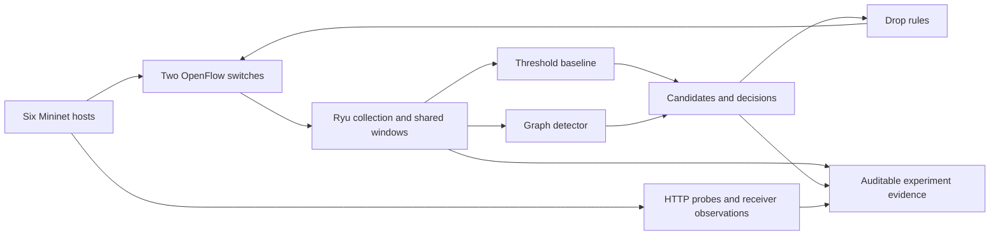

# Lantern

### Controller-integrated SDN intrusion detection

**Six hosts · Two OpenFlow switches · 95 evaluation trials · 67 passing tests**

[Results](docs/results.md) · [Methodology](docs/evaluation.md) ·
[Evidence](submission/) · [Submission guide](docs/submission.md) ·
[Team](AUTHORS.md)

Lantern compares a threshold baseline with a host-communication graph detector
inside a Ryu controller. Both receive the same observed traffic window. The
experiment asks whether graph features improve identification of a controlled
sequential-contact scenario, and measures the cost of detecting and blocking it.

The testbed has six hosts and two OpenFlow switches. All network experiments
run inside isolated Docker containers with `--network none`.

## Setup and quick checks

Requirements: Docker with Linux containers, Python 3 on the host, and Git.
The container supplies Ryu, Mininet, Open vSwitch, Scapy, and analysis tools.

```sh
make build
make validate
make datapath-check
make integration
```

Unit tests and analysis do not require privileged containers. Network experiments
require privileges to create namespaces and virtual interfaces. Userspace OVS
requires checksum and segmentation offloads to be disabled; the runner does this
before generating traffic. A ping-only check cannot verify TCP service delivery.

For an individual demonstration:

```sh
make run-case CASE=C5
```

The default demonstration observes without blocking. To demonstrate graph
mitigation, use a distinct label so existing evidence is never overwritten:

```sh
docker run --rm --privileged --network none -v "$PWD:/opt/lantern" \
  lantern-sdn-ids python3 -m experiments.run_case \
  --case C5 --label demo-C5-graph --mitigator graph --seed 9101
```

## Reproduce the evaluation

```sh
make plan
make campaign CAMPAIGN=results/campaigns/my-submission
make analyze CAMPAIGN=results/campaigns/my-submission
```

A campaign runs a pilot, three normal-only calibration trials, and 95 evaluation
trials. The requested matrix is 35 detection + 50 mitigation + 5 benign variation
+ 5 reversed-order runs. Expect several hours; the pilot prints a measured
estimate. Every trial gets a fresh container. Failed attempts remain on disk and
are retried once; two failures stop the campaign for diagnosis.

For staged execution or resumption:

```sh
python3 -m experiments.campaign create --campaign results/campaigns/my-submission
make pilot CAMPAIGN=results/campaigns/my-submission
make calibrate CAMPAIGN=results/campaigns/my-submission
make evaluate CAMPAIGN=results/campaigns/my-submission
```

Use either the all-in-one command or staged creation, not both for the same
folder. Successful trials are retained on resumption. Source changes require a
new campaign; thresholds are frozen before evaluation.

## Architecture



Detection comparisons disable mitigation. Separate runs permit exactly one
detector to actuate. The graph uses directional initiation features plus
undirected structural features and rolling host profiles. Community changes are
compared by peer membership, not community labels.

## Evidence and submission

See [evaluation methodology](docs/evaluation.md) for metric definitions and
[submission checklist](docs/submission.md) for curation and reproduction.
Legacy runs under `results/raw/` are preserved and are not final submission
claims. The completed campaign is
`results/campaigns/submission-20260922-v2`; its curated evidence lives in
`submission/`. See the [final results](docs/results.md) for measured coverage,
false positives, containment, delivery, and limitations.

All 95 evaluation trials, three normal-only calibration trials, and the pilot
passed validity checks. The primary comparison uses five trials per attack with
mitigation disabled. Each cell shows **source identified / correct class**.

| Simulated workload | Threshold baseline | Graph detector |
| --- | --- | --- |
| Port scan | 5/5 / 5/5 | 5/5 / 0/5 |
| DoS | 5/5 / 5/5 | 0/5 / 0/5 |
| SYN retry | 5/5 / 5/5 | 0/5 / 0/5 |
| Sequential contact | 5/5 / 0/5 | 5/5 / 5/5 |

The graph correctly classified sequential contact, while the baseline also
identified its source. Under legitimate peer-communication variation, false
positives occurred in **30/273 eligible windows (11.0%)** for the baseline and
**14/273 (5.1%)** for the graph. Five trials give wide uncertainty intervals;
the [full write-up](docs/results.md) reports intervals, misses, and order effects.


Mitigation evidence is more limited: graph blocking was independently verified
for 10/30 attack records; baseline blocking remained unverified. Both actuators
preserved all measured innocent-client attack and recovery HTTP requests, but
requests from the attack source suffered failures. See
[containment](submission/tables/containment.csv) and
[delivery](submission/tables/disruption.csv) for every trial.

### Verify the included evidence

```sh
make build
make validate
make verify
make package
```

`make verify` checks all evidence checksums and regenerates every published CSV
for an exact comparison. `make package` creates
`output/lantern-submission.tar.gz` and its SHA-256 sidecar from an explicit
allowlist. It refuses to overwrite an existing archive. The archive includes
source, documentation, and the curated evidence; `output/` is disposable.

To reproduce from an extracted archive:

```sh
tar -xzf output/lantern-submission.tar.gz -C /path/to/empty-directory
cd /path/to/empty-directory/lantern
make build
make validate
make verify
```

### Curate a new campaign

The included `submission/` already contains the selected campaign. For a new
campaign, select a new destination to preserve the included evidence:

```sh
docker run --rm --network none -v "$PWD:/opt/lantern" --entrypoint python3 \
  lantern-sdn-ids -m experiments.package curate \
  --campaign results/campaigns/my-submission --submission submission-new
```

The [manifest](submission/manifest.json),
[validity table](submission/tables/validity.csv),
[result-to-evidence map](submission/tables/evidence_map.csv), and
[checksums](submission/checksums.json) provide the audit trail. Detailed
resource measurements are in [overhead.csv](submission/tables/overhead.csv).

## Limits and troubleshooting

- Traffic attacks are simulations: repeated SYNs do not authenticate, and
  sequential contacts do not demonstrate successful compromise or propagation.
- The baseline is this implementation's source/pair threshold detector; results
  do not represent every per-flow method.
- Live scheduling remains variable even with seeds. Five trials are a small
  sample. Multi-attack observations within a run are dependent.
- Flow-table entries are a software occupancy proxy, not measured hardware TCAM.
- Receiver silence alone does not establish blocking. The analysis also requires
  ongoing sends, matching positive drop counters, and correlated switch replies.
- Source-wide idle-timeout rules can remain active while the host continues
  legitimate traffic. Recovery is measured, not assumed.
- ML, Suricata, redirection, production deployment, and multi-controller scaling
  are outside the submitted implementation.

If service delivery fails, inspect the run validity and process logs before
interpreting any detection result. If the datapath gate fails, use a Linux host
or a Linux VM with functioning userspace OVS. Do not run concurrent campaigns on
the same machine when measuring overhead.
