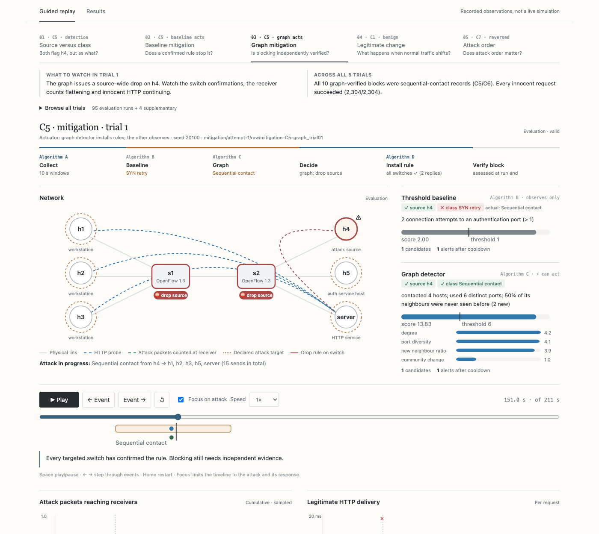
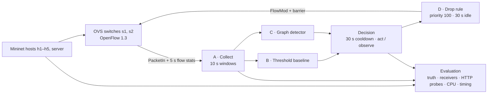

# Lantern

### Graph-based SDN controller-integrated intrusion detection and automated mitigation

**Six hosts · two OpenFlow switches · one Ryu controller · 95 evaluation trials · 99/99 runs valid · 67 passing tests**

[Results](docs/results.md) · [Methodology](docs/evaluation.md) ·
[Replay guide](docs/replay.md) · [Evidence](submission/) ·
[Submission guide](docs/submission.md) · [Team](AUTHORS.md)

Lantern runs two intrusion detectors side by side inside a Ryu SDN controller.
Both see the same 10-second observation windows:

- **Threshold baseline (Algorithm B)**: per-source and per-pair rules for port
  diversity, packet rate and repeated SYNs.
- **Graph detector (Algorithm C)**: builds a host-communication graph each
  window and scores every host against its own rolling profile (degree,
  new-neighbour ratio, port diversity, betweenness, community change).

Either detector can trigger **automated OpenFlow drop rules (Algorithm D)**. The
project asks whether network-wide graph structure helps catch internal
lateral movement that per-flow checks misread, and what that costs in latency,
controller load and collateral damage.

## Key findings

| | Threshold baseline | Graph detector |
| --- | --- | --- |
| Sequential contact (lateral) **classified correctly** | 0/5 | **5/5** |
| Primary attacks **detected** (scan, DoS, SYN retry, lateral) | **4/4 classes, 5/5 each** | 2/4 classes (missed DoS, SYN retry) |
| False alarms when legitimate traffic changes | 30/273 windows (11.0%) | **14/273 (5.1%)** |
| Drop rules confirmed / blocks **independently verified** | 25/30 / 0/30 | 10/30 / **10/30** |
| Innocent HTTP requests served during mitigation | 2,304/2,304 | 2,304/2,304 |
| Compute per 10 s window | 0.08 ms | 1.37 ms |

The two detectors are **complementary**:

- **Both find the source.** Both flag h4 in the same window, about 8.7 s after
  the attack starts. That delay is set by the window closing, not by computation.
- **Only the graph names the pattern.** The baseline calls sequential contact a
  SYN retry, because one of the contacts hits SSH port 22.
- **The label decides the response.** The graph's correct label produces a
  source-wide drop that independent evidence confirms. The baseline's mislabel
  produces a narrow h4→h1:22 pair rule, which the other contacts bypass.
- **The baseline covers more ground.** It detects every attack class. The graph
  misses single-pair floods, which have no structural signal.

Five trials per condition give wide confidence intervals, and this is one
small emulated topology. See [limits](#limits).

## Quick start

| I want to… | Run | Needs |
| --- | --- | --- |
| **See the experiments** | `python3 -m replay serve --port 8000` → [localhost:8000](http://localhost:8000) | Python 3 only |
| **Read the full results** | `python3 -m replay.report` → `output/pdf/lantern-results-report.pdf` | Python 3 + Chrome |
| **Verify the evidence** | `make build && make validate && make verify` | Docker |
| **Re-run everything** | `make campaign CAMPAIGN=results/campaigns/my-run` | Docker (privileged), several hours |

## Watch the recorded experiments

```sh
python3 -m replay serve --port 8000
```



The viewer plays back the saved logs of every trial. It runs no network
experiments and makes no external requests. It has two views:

- **Guided replay**: five chapters (C5 detection → baseline mitigation → graph
  mitigation → legitimate change → reversed order). Each chapter says what to
  watch and gives the result across all five trials.
  - A pipeline strip lights up Algorithms A → B/C → decision → D → verification
    as the run reaches each stage.
  - Detector cards show whether the source and the class were right, plus the
    score against its threshold.
  - **Focus on attack** zooms past the 135 s warmup.
- **Results**: a one-line verdict, then five plain questions, each
  answered with one picture: which attacks were caught, how often normal
  traffic caused false alarms, whether blocking actually worked, whether
  innocent users noticed, and what the graph costs. Links jump to the replay
  moment behind each answer. Definitions and the Review 1 objectives are folded
  away at the bottom.


Keyboard: Space play/pause, ← → step through events, Home restart. A link such
as `localhost:8000/#replay&chapter=3&t=151` opens a chapter at a given second.
You can also browse all 95 evaluation trials plus the separately labelled
calibration and pilot runs.

The viewer keeps detector candidates, operational alerts, switch confirmations
and independently verified blocking separate. See the [replay guide](docs/replay.md)
for what each visual does and does not show.

To export a portable copy:

```sh
python3 -m replay export --output output/lantern-replay.zip
```

Extract it, enter `lantern-replay/`, and run `python3 serve.py --port 8000`. The
server checks every file against its checksum inventory before it starts, and
it binds to localhost only.

## Results report

```sh
python3 -m replay.report
```

This verifies the curated checksums, then writes
`output/pdf/lantern-results-report.pdf` (18 pages). It covers:

- an executive summary
- Review 1 plan → delivered traceability (objectives O1–O4, cases C1–C7,
  algorithms A–D, metrics, research gaps)
- the mechanism behind each detection outcome
- a worked C5 timeline
- false alarms, mitigation, delivery and cost
- answers to research questions Q1–Q4
- limitations and per-trial appendices

The report and the viewer compute their headline numbers with the same module,
[replay/summary.py](replay/summary.py), which reads only the published tables.

## Architecture



| Case | Workload | Tests |
| --- | --- | --- |
| C1 | Normal synthetic traffic plus real HTTP probes | False-positive rate |
| C2 | TCP SYN sweep over 83 ports | Scan detection |
| C3 | 1,500 packets/s flood for 20 s | High-rate anomaly |
| C4 | 60 repeated SYNs to an auth port | Brute-force-style retries |
| C5 | Sequential contact to five internal hosts | Lateral-movement detection |
| C6 | Sequential contact then scan, heavier normal traffic | Disruption under mixed load |
| C7 | Sequential contact → scan → SYN retry (and reversed) | Head-to-head, order effects |

Detection runs disable mitigation. Mitigation runs let exactly one detector act
while the other observes. The thresholds (ports 6, hosts 4, DoS 21 packets/s,
SYN attempts 1, graph score 6) were frozen from normal-only calibration before
any attack was evaluated. The graph's community-change feature compares peer
membership, not community labels.

## Repository layout

| Path | Contents |
| --- | --- |
| `lantern/` | Ryu application: collector, features, both detectors, decision, mitigation |
| `experiments/`, `traffic/`, `topo/` | Case definitions, campaign runner, traffic generators, Mininet topology |
| `tests/` | Research unit/regression suite (67 tests) |
| `submission/` | Curated evidence: raw logs, published tables, manifest, checksums |
| `replay/` | Evidence viewer, shared result summary, PDF report builder, and their tests |
| `docs/` | Results, methodology, replay and submission guides |

`replay/` is deliberately kept outside the frozen experiment source inventory,
so changing the viewer or the report never changes the evaluated source hash.

## Setup and quick checks

Requirements: Docker with Linux containers, Python 3 on the host, and Git.
The container supplies Ryu, Mininet, Open vSwitch, Scapy, and the analysis tools.

```sh
make build
make validate
make datapath-check
make integration
```

Unit tests and analysis do not need privileged containers. Network experiments
need privileges to create namespaces and virtual interfaces. Userspace OVS needs
checksum and segmentation offloads disabled, and the runner does this before
generating traffic. A ping-only check cannot verify TCP service delivery.

For a single demonstration run:

```sh
make run-case CASE=C5
```

By default this observes without blocking. To demonstrate graph mitigation, use
a distinct label so existing evidence is never overwritten:

```sh
docker run --rm --privileged --network none -v "$PWD:/opt/lantern" \
  lantern-sdn-ids python3 -m experiments.run_case \
  --case C5 --label demo-C5-graph --mitigator graph --seed 9101
```

Replay tests (no Docker needed):

```sh
python3 -m unittest discover -s replay/tests -t .
node replay/tests/model.test.mjs   # optional; Node is not a viewer dependency
```

## Reproduce the evaluation

```sh
make plan
make campaign CAMPAIGN=results/campaigns/my-submission
make analyze CAMPAIGN=results/campaigns/my-submission
```

A campaign runs a pilot, three normal-only calibration trials and 95 evaluation
trials: 35 detection + 50 mitigation + 5 benign variation + 5 reversed order.
Expect several hours; the pilot prints a measured estimate. Every trial gets a
fresh container. Failed attempts stay on disk and are retried once. Two failures
stop the campaign for diagnosis.

For staged execution or resumption:

```sh
python3 -m experiments.campaign create --campaign results/campaigns/my-submission
make pilot CAMPAIGN=results/campaigns/my-submission
make calibrate CAMPAIGN=results/campaigns/my-submission
make evaluate CAMPAIGN=results/campaigns/my-submission
```

Use either the all-in-one command or staged creation for a given folder, not
both. Successful trials are kept on resumption. Source changes require a new
campaign, and thresholds are frozen before evaluation.

## Evidence and verification

The completed campaign is `results/campaigns/submission-20260922-v2`. Its
curated evidence lives in `submission/`. All 95 evaluation trials, three
calibration trials and the pilot passed validity checks on the first attempt.
Legacy runs under `results/raw/` are preserved but are not final submission
claims.


```sh
make build
make validate
make verify
make package
```

- `make verify` checks every evidence checksum and regenerates every published
  CSV for an exact comparison.
- `make package` builds `output/lantern-submission.tar.gz` and a SHA-256 sidecar
  from an explicit allowlist (source, documentation and curated evidence). It
  refuses to overwrite an existing archive.

The archive does not include the replay. Ship that with `replay export` above.

To reproduce from an extracted archive:

```sh
tar -xzf output/lantern-submission.tar.gz -C /path/to/empty-directory
cd /path/to/empty-directory/lantern
make build
make validate
make verify
```

To curate a new campaign, choose a new destination so the included evidence is
preserved:

```sh
docker run --rm --network none -v "$PWD:/opt/lantern" --entrypoint python3 \
  lantern-sdn-ids -m experiments.package curate \
  --campaign results/campaigns/my-submission --submission submission-new
```

These files form the audit trail:

- [manifest](submission/manifest.json)
- [validity table](submission/tables/validity.csv)
- [result-to-evidence map](submission/tables/evidence_map.csv)
- [checksums](submission/checksums.json)
- per-trial [containment](submission/tables/containment.csv),
  [delivery](submission/tables/disruption.csv) and
  [overhead](submission/tables/overhead.csv)

## Limits

- **Simulated attacks.** Repeated SYNs do not authenticate, and sequential
  contacts do not demonstrate real compromise or propagation.
- **One baseline.** It is this implementation's source/pair threshold detector
  and does not represent every per-flow method.
- **Small, dependent samples.** Five trials per condition. Live scheduling
  varies even with seeds. Multi-attack observations within a run share
  adaptive profiles.
- **Order sensitivity.** Profiles keep learning during evaluation. Reversing C7
  made both detectors miss the scan and the SYN retry.
- **TCAM is a proxy.** Flow-table entries measure software occupancy, not
  hardware TCAM.
- **Blocking needs more than silence.** A verified block also requires ongoing
  sends, positive matching drop counters and correlated switch replies.
- **Recovery is measured, not assumed.** Source-wide idle-timeout rules can stay
  active while the host keeps sending legitimate traffic.
- **Out of scope:** ML classifiers, Suricata, redirection, production deployment
  and multi-controller scaling.

If service delivery fails, inspect run validity and process logs before
interpreting any detection result. If the datapath gate fails, use a Linux host
or a Linux VM with working userspace OVS. Do not run concurrent campaigns on the
same machine while measuring overhead.
